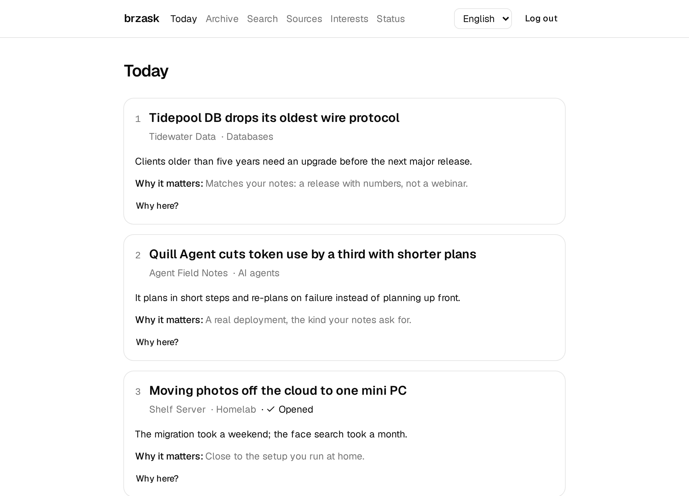
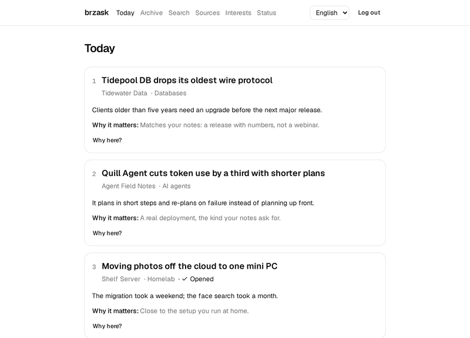
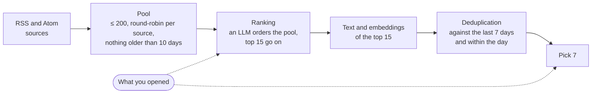

# brzask

[](https://github.com/tkabala/brzask/actions/workflows/ci.yml)
[](https://codecov.io/gh/tkabala/brzask)
[](https://tkabala.github.io/brzask/)

**A calm, finite, personal news digest: exactly 7 articles a day, learned from what you open.**

brzask is a self-hosted daily digest that reads around 200 articles a day from your RSS and Atom sources and picks exactly 7 worth reading. An endless feed asks you to keep scrolling; a fixed, short list lets you finish and get on with your day. brzask learns your taste only from what you actually open, with no ratings to give, and keeps its own source list healthy by finding new sources and muting ones you never read.

In daily use since July 2026, with more than 5,000 articles ranked so far.



<details>
<summary>A short tour: today, why an article is where it is, the archive, sources and interests</summary>



</details>

## How it picks 7



Every day the worker fetches your sources and builds a pool from fresh entries and a week of carry-over, taken in turn from each source so one chatty feed cannot fill it. An LLM ranks the whole pool against your interests and what you opened recently; the top 15 are read in full and embedded. Repeats of articles shown in the last 7 days are dropped, as are same-day duplicates (two outlets reporting one story), and the final 7 are chosen with a short reason each. Links go through brzask, so opening one is the only feedback it needs.

Around the daily digest, weekly jobs review the sources (muting those that publish a lot and are never opened), propose sites you reached through aggregators, and search the web for new sources on your interests.

## Quickstart

With Docker and Compose 2.24 or newer:

```sh
mkdir brzask && cd brzask && curl -fsSLO https://raw.githubusercontent.com/tkabala/brzask/main/deploy/compose.yaml
docker compose run --rm setup
docker compose up -d
```

`setup` asks for a login password and an LLM API key and writes them, with generated secrets, to `./secrets`. Then open <http://localhost:8000>, add a few feeds under *Sources* and interests under *Interests*; the first digest is built at 07:00. To look around first, `docker compose run --rm migrate seed-demo` fills an empty instance with a month of invented digests.

The [documentation](https://tkabala.github.io/brzask/) covers [installation](https://tkabala.github.io/brzask/install/) with the optional crawler and search services, [providers](https://tkabala.github.io/brzask/providers/) such as Ollama for a fully local setup, a [reverse proxy](https://tkabala.github.io/brzask/reverse-proxy/), [backups](https://tkabala.github.io/brzask/backup/) and verifying the signed image.

## Configuration

Settings are environment variables, read from a `.env` file next to `compose.yaml`. The ones most installs touch:

| Variable | Default | What it sets |
|---|---|---|
| `TZ` | `UTC` | Time zone of the schedule and of digest dates |
| `DIGEST_AT` | `07:00` | When the daily digest is built |
| `DIGEST_LANGUAGE` | `en` | Language of digest titles and summaries (`en`, `pl`) |
| `LLM_BASE_URL` | `https://openrouter.ai/api/v1` | Any OpenAI-compatible API: OpenRouter, Ollama, … |
| `LLM_MODEL` | `deepseek/deepseek-v4-flash` | Model that ranks and selects |
| `EMBEDDING_MODEL` | `google/gemini-embedding-001` | Embedding model; `brzask reembed` switches stored vectors |
| `EXTRACTORS` | `feed,trafilatura,jina` | How article text is read, tried in order |
| `WEB_SEARCH` | (off) | Source discovery: `llm-online`, `searxng` or `brave` |
| `AUTH_MODE` | `password` | `password`, `header` (behind an auth proxy) or `none` |

Every variable, with its default and description, is in the [configuration reference](https://tkabala.github.io/brzask/configuration/) and in [`.env.example`](.env.example). One OpenRouter key covers ranking, embeddings and the judge; for a fully local setup point the URLs at Ollama.

## How is this different

- **Horizon** scores each article 0–10 and keeps those above a threshold; brzask ranks articles against each other and always shows 7.
- **CondenseIt** learns from stars you give; brzask learns from what you open and asks for nothing.
- **Kagi News** gives everyone the same finite list; brzask's list is yours, from your sources and interests.
- **RSS readers** (Miniflux, FreshRSS, Folo) are inboxes that fill up; brzask is a short list you finish.

## Design decisions

- **Rank, don't score.** Asked for 0–10 scores, the LLM gave exactly 8 to 196 of 294 articles in the daily top 15, so a threshold cannot separate them; ranking the pool and keeping a fixed 7 can. ([ADR 0010](docs/decisions/0010-rank-candidates-and-show-a-fixed-seven.md))
- **Opens are the only signal.** In daily use, explicit ratings were given up within days, twice; opening an article costs nothing and says enough. ([ADR 0011](docs/decisions/0011-opens-are-the-only-preference-signal.md))
- **Deduplication measured per model.** Every real repeat of a shown article had cosine ≥ 0.962 and distinct articles ≤ 0.959, so 0.96 drops repeats across days; same-day duplicates sit at 0.80–0.88, where a threshold that adapts to the day and a judge for the grey zone decide. ([ADR 0012](docs/decisions/0012-embedding-deduplication-across-days-and-within-the-day.md), [ADR 0007](docs/decisions/0007-a-judge-decides-same-day-duplicates-in-the-grey-zone.md))
- **The article, not the page.** Trafilatura read 50 of 54 links (93%) at a median 262 ms, as often as a hosted reader at 3.4 s, so it is the default extractor. ([ADR 0002](docs/decisions/0002-trafilatura-as-the-default-page-extractor.md))
- **Measure, don't guess.** `brzask replay` rebuilds past days with a candidate change and counts how many picks were actually opened. Baseline over 28 days: 19 of 195 shown articles were opened (10%); replayed picks, which can hardly beat that as only shown articles could be opened, got 10 of 193 (5%). Thresholds change only with such evidence. ([ADR 0017](docs/decisions/0017-measure-changes-by-replaying-past-days.md), [measuring](docs/measuring.md))

All decisions are recorded in [`docs/decisions`](docs/decisions/index.md).

## Development

Backend in Python 3.13 (FastAPI, SQLAlchemy, Postgres with pgvector), frontend in React with TypeScript. With [mise](https://mise.jdx.dev/) and [just](https://just.systems/):

```sh
mise install && just setup
just dev      # database and the frontend dev server
just api      # the API on the dev database
just check    # lint, type-check and test everything
```

Conventions are in [`CLAUDE.md`](CLAUDE.md); the [documentation](https://tkabala.github.io/brzask/) covers the [architecture](https://tkabala.github.io/brzask/architecture/), data model, API, frontend and measuring changes.

## License

[MIT](LICENSE)
