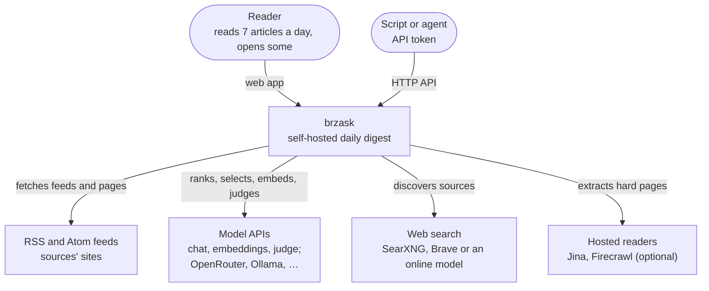
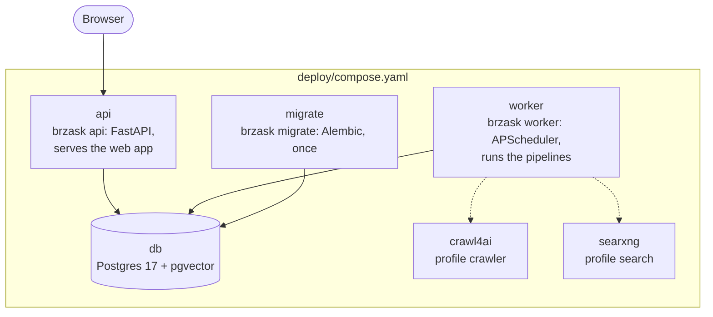
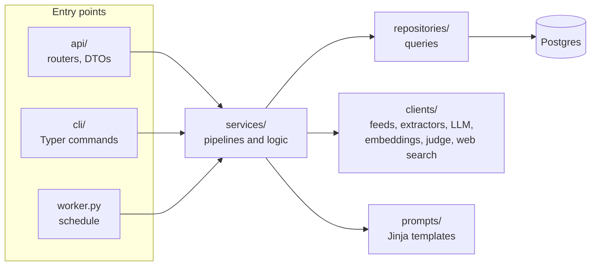
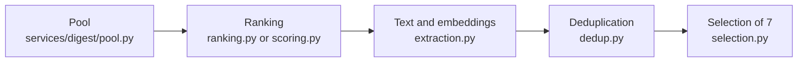

# Architecture

The diagrams follow the [C4 model](https://c4model.com): the system in its
surroundings, the containers it runs as, and the parts of the backend.

## System context

Links in the digest point at brzask (`/open`), which records the open and
redirects to the article. Opens are the only feedback the reader gives
([ADR 0011](decisions/0011-opens-are-the-only-preference-signal.md)).

## Containers

All four default containers run one image with a different command
([ADR 0021](decisions/0021-one-image-for-every-command.md)). `migrate` runs
before the others start and exits. The worker has no queue: each pipeline
runs at its time, holding a Postgres advisory lock, and records itself in
`runs` ([ADR 0020](decisions/0020-one-worker-process-with-a-scheduler-and-no-queue.md)).
`brzask run <pipeline>` does the same from the command line.

## Backend components

- **Entry points** parse input and call services; no logic lives in a
  router or a command.
- **Services** hold the pipelines (`digest/`, `review`, `visited`,
  `discovery`) and everything else: sources, interests, opens, search,
  replay and the benchmarks.
- **Repositories** own every query, with the typed SQLAlchemy ORM
  ([ADR 0019](decisions/0019-typed-sqlalchemy-and-raw-sql-only-where-needed.md)).
- **Clients** talk to the outside: one OpenAI-compatible client per role,
  with retries and usage metering, and an extractor chain tried in the order
  of `EXTRACTORS`.

## The daily digest

| Stage | What it does | Decision |
|---|---|---|
| Pool | Fresh entries and a week of carry-over, without stale or shown links, up to 200 taken in turns per source | [ADR 0016](decisions/0016-the-pool-takes-sources-in-turns.md) |
| Ranking | The LLM orders the pool; top 15, at most 2 per source | [ADR 0010](decisions/0010-rank-candidates-and-show-a-fixed-seven.md), [ADR 0006](decisions/0006-llm-ranking-stays-the-default-over-composite-scores.md) |
| Text and embeddings | Extractors in turn, the first 4,000 characters embedded | [ADR 0002](decisions/0002-trafilatura-as-the-default-page-extractor.md), [ADR 0022](decisions/0022-one-embedding-model-at-a-time-with-thresholds-per-model.md) |
| Deduplication | Against 7 days of shown articles, then within the day | [ADR 0012](decisions/0012-embedding-deduplication-across-days-and-within-the-day.md), [ADR 0007](decisions/0007-a-judge-decides-same-day-duplicates-in-the-grey-zone.md) |
| Selection | The LLM picks 7 and writes title, summary and why it matters | [ADR 0010](decisions/0010-rank-candidates-and-show-a-fixed-seven.md) |

If the selection fails, nothing is marked as shown and the candidates stay
in the pool for the next run. The data each stage reads and writes is
described in [Data model](data-model.md).
