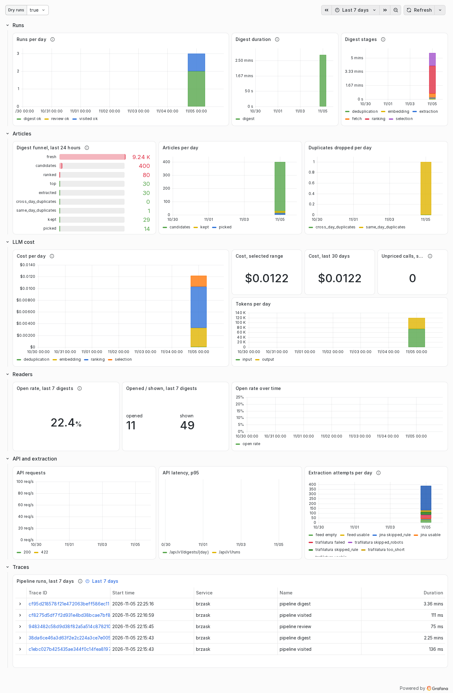

# Observability

brzask measures every pipeline run, the cost of its LLM and embedding calls,
how many articles each digest stage leaves and how many of the digest's
articles get opened. It sends these metrics, and a trace of every run, over
OTLP to whatever collector `OTEL_EXPORTER_OTLP_ENDPOINT` points at.

The `observability` profile of the compose file brings a complete set to
look at them: an [OpenTelemetry Collector](https://opentelemetry.io/docs/collector/),
[Prometheus](https://prometheus.io) for metrics, [Tempo](https://grafana.com/oss/tempo/)
for traces and [Grafana](https://grafana.com/oss/grafana/) with a ready
dashboard. It is off by default; brzask runs the same without it.



## Turning it on

The profile reads its configuration from an `observability` folder next to
`compose.yaml`. Fetch it once, from the same directory:

```sh
curl -fsSL https://github.com/tkabala/brzask/archive/refs/heads/main.tar.gz \
  | tar -xz --strip-components=2 brzask-main/deploy/observability
```

Then add to `.env`:

```sh
COMPOSE_PROFILES=observability
OTEL_EXPORTER_OTLP_ENDPOINT=http://otel-collector:4318
```

With other profiles, list them together: `COMPOSE_PROFILES=crawler,observability`.
Run `docker compose run --rm setup` again (it keeps the existing secrets and
adds `./secrets/grafana_admin_password`), then `docker compose up -d`.

Grafana listens on <http://localhost:3000>; log in as `admin` with the
password from `./secrets/grafana_admin_password`. Like the web app, it is
published on the loopback address only: set `GRAFANA_PUBLISH=3000` to reach it
from other machines, or put it behind your reverse proxy. Prometheus and
Tempo are reachable only from Grafana.

Grafana is set up to make no requests of its own outside the machine: no
usage reports, update checks, news feed, avatars or plugin downloads.

## Retention and disk

| Store | Keeps | Volume |
|---|---|---|
| Prometheus | 400 days of metrics | `prometheus-data` |
| Tempo | 14 days of traces | `tempo-data` |
| Grafana | its own settings | `grafana-data` |

History starts when the profile is turned on: the dashboard does not read the
database, so runs from before do not appear. The status page and the run
history in the app always cover every run.

## The dashboard

The `brzask` dashboard is Grafana's home page. It shows real runs; the *Dry
runs* switch at the top shows runs started with `--dry-run` instead.

- **Runs:** runs per day by pipeline and outcome, the digest's duration and
  the time spent in each of its stages.
- **Articles:** the digest funnel (fresh entries, candidates, ranked, top,
  extracted, duplicates dropped, kept, picked) for today and per day.
- **LLM cost:** cost per day by purpose, totals for the selected range and
  the last 30 days, tokens, and calls whose provider reported no cost (their
  cost is missing from the totals).
- **Readers:** the share of the last seven digests' articles that were opened.
- **API and extraction:** requests and latency of the API, and each page
  extractor's attempts by outcome.
- **Traces:** recent pipeline runs; open one to see its every LLM, embedding,
  HTTP and SQL call in order, with the model, tokens and cost on each call.

Daily counts are exact: Prometheus runs with
`created-timestamp-zero-ingestion` and `promql-extended-range-selectors`, and
the panels use `anchored` ranges, so a day with one run shows one run.

## Metrics

Names as Prometheus stores them. Every run metric has the labels `kind`
(`digest`, `review`, `visited`, `discovery`) and `dry_run`.

| Metric | Type | Labels | What it counts |
|---|---|---|---|
| `brzask_pipeline_runs_total` | counter | `status` | Finished runs: `ok`, `skipped`, `failed` |
| `brzask_pipeline_duration_seconds` | histogram | `status` | Duration of a run |
| `brzask_pipeline_stage_duration_seconds` | histogram | `stage` | Duration of each stage of a run |
| `brzask_llm_cost_USD_total` | counter | `purpose` | Cost the provider reported, in US dollars |
| `brzask_llm_tokens_total` | counter | `purpose`, `type` | Input and output tokens |
| `brzask_llm_unpriced_calls_total` | counter | `purpose` | Calls without a reported cost |
| `brzask_digest_articles_total` | counter | `stage` | Articles at each digest stage |
| `brzask_digest_shown` | gauge | `days` | Articles shown in the last 7 digests |
| `brzask_digest_opened` | gauge | `days` | Of those, articles opened |
| `brzask_extraction_attempts_total` | counter | `extractor`, `domain`, `outcome` | Page extraction attempts |
| `http_server_request_duration_seconds` | histogram | `http_route`, `http_response_status_code`, … | API requests |

The run metrics come from the worker (and from `brzask run` on the command
line); the open-rate gauges and request metrics come from the API, which also
serves them on [`/metrics`](api.md#probes-and-metrics) without a collector.
Resource attributes `service_name`, `service_version` and `brzask_component`
(`api`, `worker`, `cli`) are labels too.

## Another backend

Nothing in brzask depends on this profile. Point
`OTEL_EXPORTER_OTLP_ENDPOINT` at any OTLP/HTTP endpoint (Grafana Cloud,
Honeycomb, SigNoz, an existing collector) and leave the profile off. The
metric names above are the OpenTelemetry ones with dots turned into
underscores and the unit appended; other backends may spell them closer to
the original, such as `brzask.pipeline.duration`.
